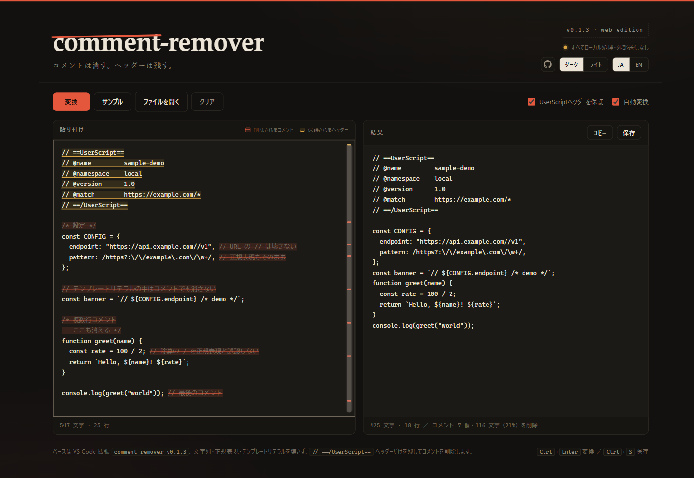

# comment-remover

JavaScript / UserScript からコメントだけを削除する、ブラウザだけで動くツールです。
VS Code 拡張 `comment-remover v0.1.3` の解析ロジックをそのまま移植しています。

**公開URL: https://imu31465.github.io/comment-remover/**



## 開き方

`index.html` をダブルクリックするだけです。サーバーもビルドも不要で、
完全にローカル（オフライン）で動作します。外部への通信は一切ありません。

## 機能

- **貼り付け → 自動でコメント削除**（`自動変換` をオフにすれば `変換` ボタン / `Ctrl+Enter`）
- **レダクションプレビュー**: 消されるコメントが入力側で赤い取り消し線、
  保護される `// ==/UserScript==` ヘッダーが琥珀色で表示されます
- **自作スクロールバー**: 削除箇所（赤）/ ヘッダー（琥珀）の位置にマーカーを表示。
  クリックでその場所へジャンプ＋ハイライト、ドラッグでスクロール、
  `↑ ↓ / PageUp / PageDown / Home / End` にも対応
- **ダーク / ライトテーマ切替**（選択は保存されます）
- **日本語（デフォルト）/ English 切替**（選択は保存されます）
- 文字列・テンプレートリテラル・正規表現リテラルをコメントと誤認しません
  （`https://…` や `/ab\/c/g` はそのまま残ります）
- ファイルを開く（ドラッグ & ドロップ対応）。**読み込み時は必ず先頭から表示**（末尾へスクロールしません）
- 結果のコピー / 保存（`Ctrl+S`）。ドロップしたファイル名に合わせて `<name>.cleaned.user.js` として保存
- **大きいファイル対応**: 数百万文字クラスのバンドルでもハイライトされます。
  描画は 400 行ごとのブロック単位で行い、**表示範囲外のブロックは DOM から外して固定高さに置き換える**
  ため、巨大ファイルでも軽快にスクロールできます
  （2,000万文字・削除 50万箇所を超える場合のみ色付けを省略し、フッターに注記）

## テスト（拡張本体との出力一致検証）

```powershell
node test/parity.test.mjs
# 拡張のパスを明示する場合:
node test/parity.test.mjs "C:\path\to\extension.js"
```

- `extension/` 内のソース（見つからなければインストール済み拡張）と出力が完全一致するか検証します
- 静的コーパス + 乱数 3,000 ケース ×（ヘッダー保護 ON / OFF）

## 構成

```
comment-remover/
├── index.html            # Web 版 本体（CSS / JS すべて内蔵）
├── preview.png           # スクリーンショット（ダーク）
├── preview-light.png     # スクリーンショット（ライト）
├── README.md
├── extension/            # VS Code 拡張（v0.1.3）のソース
│   ├── extension.js
│   ├── package.json
│   ├── README.md
│   ├── CHANGELOG.md
│   └── .vscode/launch.json
└── test/
    └── parity.test.mjs   # パリティテスト
```

## デプロイ

GitHub Pages（`main` ブランチ / ルート）で公開中です。`git push` で自動反映されます。
その他の静的ホスト（Cloudflare Pages / Vercel / Netlify など）にもそのまま置けます。

## English

A browser-only tool that strips comments from JavaScript / UserScript while keeping the
`// ==/UserScript==` header — and never breaking strings, regexes, or template literals.
Open `index.html`; no build, no server, fully offline.

- Live: https://imu31465.github.io/comment-remover/
- Custom scroll rail with markers: jump to removed comments (red) or the protected header (amber)
- Dark / light theme and JA / EN language toggles (saved locally)
- VS Code extension source (v0.1.3): see `extension/`
